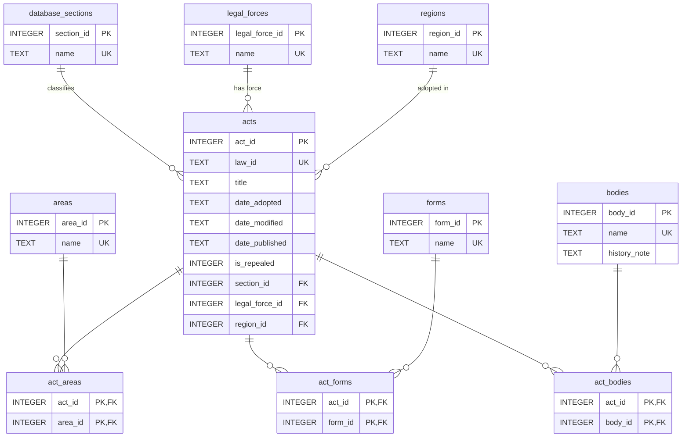

# ER diagram

SQLite schema created by `src/db.py` (menu item 7). GitHub renders the diagram below.

## Normalisation decisions

| Flat column                                       | Problem                                                                                                                   | Solution                                                                  |
| ------------------------------------------------- | ------------------------------------------------------------------------------------------------------------------------- | ------------------------------------------------------------------------- |
| `legal_relation_area`                           | several areas in one cell, separated by commas that also occur inside the names                                           | `areas` + link table `act_areas` (many-to-many)                       |
| `act_form`                                      | several forms in one cell, written in a different order (`Шешім, Өзгерту` / `Өзгерту, Шешім`) | `forms` + `act_forms`; the order no longer matters                    |
| `adopting_body`                                 | joint acts of several bodies; history of the body in parentheses                                                          | `bodies` + `act_bodies`; the note is moved to `bodies.history_note` |
| `database_section`, `legal_force`, `region` | the same long string repeated in thousands of rows                                                                        | lookup tables, `acts` keeps integer foreign keys                        |
| `database_section` = `3700`, `3800`         | numeric codes instead of names (19 rows)                                                                                  | stored as NULL (unknown section)                                          |
| `adilet_url`                                    | fully derived from `law_id`                                                                                             | not stored: `https://adilet.zan.kz/rus/docs/` + `law_id`              |
| `is_archive`                                    | constant                                                                                                                  | not stored                                                                |

Row counts for the full dataset are in `reports/full/database_report.json`.
